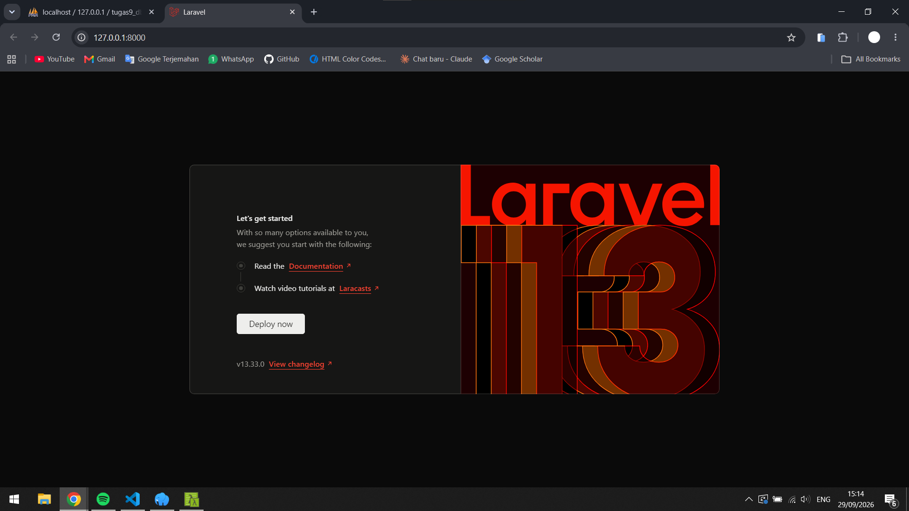

# TugasWeb-P9-LaravelSetup

Tugas Rutin 9 mata kuliah Pemrograman Web: Setup Laravel

## Data Mahasiswa

| Nama           | Muhammad Raihan Syahfitrah                              |
| NIM            | 4253250032                                              |
| Kelas          | PSIK 25A                                                |
| Program Studi  | Ilmu Komputer                                           |

## Deskripsi Proyek

Proyek ini adalah hasil setup awal framework Laravel menggunakan Laragon dan Composer. Di dalamnya terdapat tiga halaman (Home, About, dan Contact) yang dibuat lewat route dan Blade view, satu controller, satu model beserta migrasi database, dan penampilan data dinamis yang dikirim dari route ke view.

## Teknologi yang Digunakan

| Teknologi          | Keterangan                                    |
| ------------------ | --------------------------------------------- |
| Laravel            | Framework PHP, versi 13.33.0                  |
| PHP                | Versi 8.3.33                                  |
| Composer           | Pengelola paket PHP                           |
| Laragon            | Lingkungan pengembangan lokal (Apache, MySQL) |
| MySQL              | Basis data, dikelola lewat phpMyAdmin         |
| Blade              | Template engine bawaan Laravel                |
| Visual Studio Code | Editor kode                                   |

## Daftar Halaman (Route)

| URL        | Penanganan                       | View                              | Keterangan                                         |
| ---------- | -------------------------------- | --------------------------------- | -------------------------------------------------- |
| `/`        | Closure di `routes/web.php`      | `resources/views/home.blade.php`  | Halaman utama                                      |
| `/about`   | Closure di `routes/web.php`      | `resources/views/about.blade.php` | Menampilkan data dinamis berupa array daftar skill |
| `/contact` | `PageController@contact`         | `resources/views/contact.blade.php` | Menampilkan data kontak dari controller          |

## Prasyarat

Pastikan perangkat sudah memiliki:

1. Laragon (dengan Apache dan MySQL aktif)
2. PHP versi 8.2 atau lebih baru
3. Composer
4. Git

## Langkah Instalasi

1. Jalankan Laragon, lalu klik **Start All**.
2. Buka terminal Laragon, masuk ke folder `www`, lalu clone repository:

   ```bash
   git clone https://github.com/KamisakiNara/TugasWeb-P9-LaravelSetup.git
   cd TugasWeb-P9-LaravelSetup
   ```

3. Pasang seluruh dependensi:

   ```bash
   composer install
   ```

4. Salin file pengaturan lingkungan:

   ```bash
   copy .env.example .env
   ```

5. Buat application key:

   ```bash
   php artisan key:generate
   ```

6. Buka phpMyAdmin (`http://localhost/phpmyadmin`), lalu buat database baru bernama `tugas9_db`.
7. Buka file `.env`, lalu sesuaikan bagian database:

   ```
   DB_CONNECTION=mysql
   DB_HOST=127.0.0.1
   DB_PORT=3306
   DB_DATABASE=tugas9_db
   DB_USERNAME=root
   DB_PASSWORD=
   ```

8. Jalankan migrasi untuk membuat tabel:

   ```bash
   php artisan migrate
   ```

9. Jalankan server pengembangan:

   ```bash
   php artisan serve
   ```

10. Buka `http://127.0.0.1:8000` di browser.

Catatan: jika muncul error bahwa tabel `sessions` tidak ditemukan, artinya langkah 8 (migrasi) belum dijalankan.

## Struktur Folder

```
TugasWeb-P9-LaravelSetup/
├── app/
│   ├── Http/
│   │   └── Controllers/
│   │       └── PageController.php
│   └── Models/
│       └── Pesan.php
├── database/
│   └── migrations/
├── docs/
│   └── welcome.png
├── public/
│   └── index.php
├── resources/
│   └── views/
│       ├── home.blade.php
│       ├── about.blade.php
│       └── contact.blade.php
├── routes/
│   └── web.php
├── .env
└── README.md
```

### Penjelasan Folder dan File Utama

| Folder atau File               | Fungsi                                                                                                    |
| ------------------------------ | --------------------------------------------------------------------------------------------------------- |
| `app/`                         | Berisi logika utama aplikasi.                                                                             |
| `app/Http/Controllers/`        | Tempat controller, yaitu class yang mengatur alur permintaan dan memilih view yang ditampilkan.           |
| `app/Models/`                  | Tempat model, yaitu class yang mewakili satu tabel di database.                                           |
| `database/migrations/`         | Berisi rancangan struktur tabel. Dengan `php artisan migrate`, rancangan ini dijadikan tabel sungguhan.   |
| `public/`                      | Satu-satunya folder yang dapat diakses langsung dari browser. Berisi `index.php` sebagai pintu masuk aplikasi. |
| `resources/views/`             | Tempat file tampilan dengan ekstensi `.blade.php`.                                                        |
| `routes/web.php`               | Daftar alamat URL beserta apa yang dijalankan ketika alamat itu dibuka.                                   |
| `.env`                         | Pengaturan lingkungan seperti koneksi database. File ini tidak diunggah ke GitHub demi keamanan.          |
| `vendor/`                      | Hasil instalasi paket dari Composer. Dibuat otomatis dan tidak perlu diubah.                              |

## Penjelasan Perintah Artisan yang Digunakan

| Perintah                                     | Hasil                                                              |
| -----------------------------------------    | ------------------------------------------------------------------ |
| `php artisan make:controller PageController` | Membuat file `app/Http/Controllers/PageController.php`          |
| `php artisan make:model Pesan -m`            | Membuat model `Pesan` sekaligus file migrasi tabel `pesans`        |
| `php artisan migrate`                        | Membuat tabel di database sesuai file migrasi                      |
| `php artisan serve`                          | Menjalankan server pengembangan di `http://127.0.0.1:8000`         |

## Tangkapan Layar

### Halaman Welcome Laravel (php artisan serve)



## Pemenuhan Ketentuan Tugas

| No | Ketentuan                                                       | Status  |
| -- | --------------------------------------------------------------- | ------- |
| 1  | Install Composer dan membuat project dengan composer create-project | Selesai |
| 2  | Membuat database di phpMyAdmin dan konfigurasi `.env` (MySQL)   | Selesai |
| 3  | `artisan serve` berjalan dan tangkapan layar halaman welcome    | Selesai |
| 4  | Tiga route custom (`/`, `/about`, `/contact`) yang mengembalikan Blade view | Selesai |
| 5  | View menampilkan data dinamis (array dari route)                | Selesai |
| 6  | Menggunakan `make:controller` dan `make:model -m`               | Selesai |
| 7  | README berisi langkah instalasi dan penjelasan struktur folder  | Selesai |
| 8  | Nama repository `TugasWeb-P9-LaravelSetup`                      | Selesai |

## Identitas Pembuat

Muhammad Raihan Syahfitrah
Ilmu Komputer, Fakultas Matematika dan Ilmu Pengetahuan Alam
Universitas Negeri Medan# TugasWeb-P9-LaravelSetup
